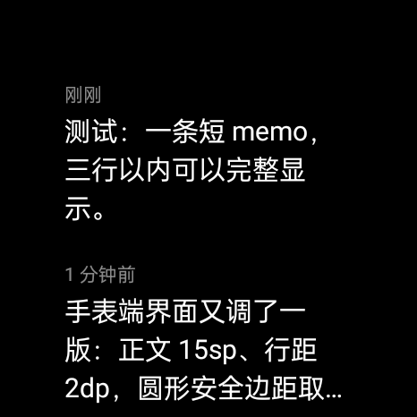

# Memos Watch

一个为圆形屏幕手表打造的 [Memos](https://github.com/usememos/memos) 原生客户端。纯黑 AMOLED 界面、零第三方运行时依赖，专为小屏阅读做了取舍：列表只露三行，想看全文点进去。



> 实机截图：OPPO Watch X3 Mini（OWW263，Android 11，466×466，320dpi）

## 特性

- **打开即读**：启动或从后台回到前台时拉取最近 10 条 memo，按时间倒序；不做多余的手动刷新入口
- **三行截断**：列表每条最多 3 行，超出部分显示省略号；只有真正被截断的条目才可点击，点进详情页看全文
- **左滑返回**：详情页从屏幕左侧边缘向右滑即可返回，与系统手势一致，不占用屏幕空间
- **纯文本渲染**：把 Markdown 转成纯文本（标题、列表、引用、强调、链接、代码围栏、HTML 标签等），不加载图片与附件
- **相对时间**：刚刚 / N 分钟前 / N 小时前 / N 天前 / M月D日
- **圆屏友好**：按内接正方形计算安全留白（`0.1465 × 直径`），任何一行文字都不会被圆边裁掉；纯黑底省电，阅读期间保持常亮
- **失败可重试**：网络异常或 Token 失效时给出中文提示，点按即可重试；已有内容时刷新失败只做轻提示

## 兼容性

- 最低 Android 11（API 30）
- 面向"可直接安装 APK 的圆形手表"（ColorOS Watch 等），不依赖 Wear OS 或 Google Play 服务
- 已在 OPPO Watch X3 Mini（466×466 / 320dpi）上验证；其他分辨率按比例自适应

## 构建

需要 JDK 17+、Android SDK Platform 35。

```bash
cp local.properties.example local.properties
# 填入 sdk.dir、MEMOS_BASE_URL、MEMOS_TOKEN
./gradlew assembleRelease
```

产物：`app/build/outputs/apk/release/app-release.apk`

### 配置项（`local.properties`，不提交到仓库）

| Key | 说明 |
| --- | --- |
| `sdk.dir` | Android SDK 路径 |
| `MEMOS_BASE_URL` | Memos 服务地址，例如 `https://memos.example.com` |
| `MEMOS_TOKEN` | 在 Memos 的「设置 → 访问令牌」中创建 |
| `RELEASE_STORE_FILE` 等 | 可选，release 签名配置；不填则 release 包不签名 |

也可以使用同名环境变量代替。注意：地址与令牌会通过 `BuildConfig` 编译进 APK，请为手表单独创建权限最小的令牌，不要公开分发自用构建产物。

## 实现说明

- 纯 Framework View，无 AndroidX / Compose / OkHttp：APK 约 50 KB
- 网络层用 `HttpURLConnection` + `org.json`，单后台线程回调主线程
- 列表与详情的正文宽度一致，避免"列表里被截断、详情里其实只有三行"
- 圆屏安全区：`inset = 0.1465 × min(宽, 高) + 2dp`
- 图标由 `tools/make_icon.py` 生成：用 fontTools 提取 Georgia Bold 的 "Memos" 字形轮廓，输出为矢量自适应图标（`TARGET_WIDTH` 控制字标大小）

```
app/src/main/java/com/imaegoo/memoswatch/
├── MainActivity.kt     # 列表：拉取、三行截断判定、点击进入详情
├── DetailActivity.kt   # 详情：全文滚动 + 左缘右滑返回
├── MemosApi.kt         # /api/v1/memos 请求与解析
├── Markdown.kt         # Markdown → 纯文本
└── Format.kt           # 相对时间、dp、时间格式化
```

## 许可证

[MIT](LICENSE)
